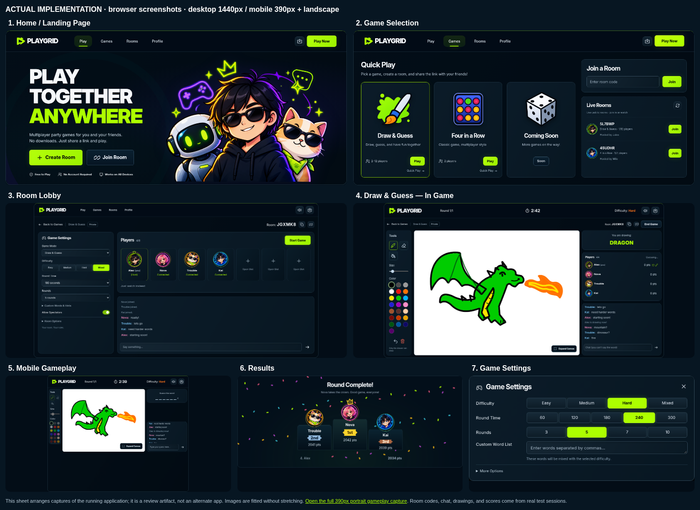

# Playgrid 2.0 — visual review and QA

This branch implements the owner's seven-screen storyboard inside the existing Express + Socket.IO `node-server` application. The approved image attached to the Codex task is the visual target. PR #12 was inspected read-only and was not modified or merged. No Render configuration, deployment, or production service was touched.

## Actual website screenshots

These are browser captures of the actual multiplayer application, not static mockups. Desktop captures use a 1440 × 900 viewport; portrait mobile uses 390 × 844. Full-page captures can be taller than their viewport. The landscape phone shown in the reference is also checked separately at 780 × 390.



| Screen | Desktop | Mobile |
| --- | --- | --- |
| Landing | [1440px](screenshots/playgrid-2/01-landing-desktop.png) | [390px](screenshots/playgrid-2/01-landing-mobile.png) |
| Game selection | [1440px](screenshots/playgrid-2/02-games-desktop.png) | [390px](screenshots/playgrid-2/02-games-mobile.png) |
| Room lobby | [1440px](screenshots/playgrid-2/03-lobby-desktop.png) | [390px](screenshots/playgrid-2/03-lobby-mobile.png) |
| Draw & Guess | [1440px](screenshots/playgrid-2/04-drawing-desktop.png) | [390px portrait](screenshots/playgrid-2/05-gameplay-mobile-390.png), [phone landscape](screenshots/playgrid-2/05-gameplay-mobile-landscape.png) |
| Results | [1440px](screenshots/playgrid-2/06-results-desktop.png) | [390px](screenshots/playgrid-2/06-results-mobile.png) |
| Settings | [1440px](screenshots/playgrid-2/07-settings-desktop.png) | [390px](screenshots/playgrid-2/07-settings-mobile.png) |
| Four in a Row regression | [Actual match](screenshots/playgrid-2/08-four-in-a-row-desktop.png) | Responsive layout shares the same room shell |

[Open the seven-screen review sheet](playgrid-2-review.html). `panel-*` images are element screenshots from the same running sessions, used to arrange the comparison sheet without stretching them.

## Comparison with the approved storyboard

Visual review was performed against the attached storyboard after actual browser capture. This is a visual comparison, not a claimed numerical pixel-diff or proof of pixel equivalence. The original storyboard is a composited image with panels of different sizes; the portrait adaptation is reviewed separately.

| Reference composition | Implemented treatment and remaining differences |
| --- | --- |
| Large three-line PLAY / TOGETHER / ANYWHERE, outlined frame, gamer/robot/cat group, neon doodles, two CTAs and trust cues | Recreated composition and original illustrated character group, with local artwork. Characters, ink strokes, glow and clothing are newly generated rather than extracted originals; their exact silhouettes and details differ. Self-hosted Inter approximates the reference lettering; the source font is unknown. |
| Three illustrated game cards; join-code panel; two room rows | Original brush, board and dice vectors, lime selected card, actual join form and real public-room browser. Card artwork is hand-drawn SVG and differs in shading and contour from the reference. The panel says **Live Rooms**, because the backend lists live public rooms and does not persist a personal room history. Quick Play remains a real action below each playable card. |
| Settings sidebar, horizontal illustrated player cards, code, chat, Start Game | The same server room now uses that layout. Avatars use detailed original portrait artwork, with the existing 24 avatar indices and ten accent colors. **Connected** replaces illustrative Ready / Not Ready labels because there is no ready-up protocol. Extra room/word controls remain available in disclosures. |
| Vertical tools, large white canvas, header timer/difficulty, secret word, player rankings and chat | The layout uses the original shared 800 × 600 canvas and real timers, guesses, scores, fill and undo. Final desktop comparison increased tools and right-column proportions to better match the reference. The dragon was drawn through real brush/bucket pointer input; it is not the exact storyboard dragon and is not an inserted background image. No pretend text tool or redo was added: those operations do not exist in the drawing protocol. |
| Landscape phone with compact tools and chat | Both landscape and true 390px portrait are captured. Portrait stacks the white canvas and chat, with an expandable player roster. Color targets were enlarged to 24px and the palette scrolls to retain all 22 colors. The landscape view is an actual viewport capture, without an invented physical phone frame. |
| Confetti and a 2nd / 1st / 3rd podium | CSS podium, original portraits, crown, ribbons and confetti use actual server standings after a complete game. Names, ranks and points reflect the run and intentionally do not copy the illustrative scores. A fourth-place row is shown for the fourth real player. |
| Compact settings with lime difficulty/time/round buttons | Recreated dialog with real persisted segmented controls. All other supported timer and round values, hints and custom-only mode remain under More Options. Non-host and in-game views are read-only with an explanation. The disclosure is an extra row relative to the storyboard. |

The first browser pass revealed duplicate hero doodles, an oversized settings dialog and a long lobby sidebar. Subsequent passes removed duplicate doodles, condensed the dialog, moved advanced options into disclosures, installed the detailed portrait sprite and refined desktop panel proportions. Mobile review replaced the always-open player panel with a real expandable roster. Accessibility scanning then found small color targets and a non-focusable scrolling chat; both were corrected and the full browser suite was rerun.

The implementation is ready for **owner visual review**, not a claim that the recreated assets are pixel-identical to the approved image.

## Functional verification

- `cd node-server && npm test`: all four suites passed, **196 PASS assertions, zero failures**. Covers word selection/difficulty, gameplay, lobby safety, spectators, reconnect, server-side word secrecy, rate limits and private-alpha HTTP/Socket.IO access control.
- `scripts/playgrid_visual_qa.py`: independent browser contexts create and join a room, synchronize host settings and chat, complete a four-player Draw & Guess game, switch that same room to Four in a Row and play a real win.
- The browser suite compares actual canvas pixels across all four clients after strokes and paint fills, checks undo replay, expand/Escape, socket reconnect, late spectator sync and secret-word isolation.
- It verifies read-only guest controls, modal keyboard trapping/restoration, mobile roster controls, absence of horizontal overflow on every mobile screen, and that the mobile chat input stays within the 844px viewport.
- A separate temporary local server tests real private-alpha browser login. An authenticated context loads the redesigned frontend and joins a room; a new unauthenticated context remains gated. Its temporary credential is generated in memory and never saved to the repository.
- axe-core 4.10.3 scans the captured desktop/mobile screens for WCAG A/AA violations. See [accessibility results](screenshots/playgrid-2/accessibility-results.json). Automated checks do not replace manual screen-reader or physical-device testing.
- See [browser results](screenshots/playgrid-2/qa-results.json) for the completed checks and real standings. No JavaScript page errors or missing artwork requests were observed in the final run.

## Reproduce

The application adds no runtime dependencies and leaves `package.json` and `package-lock.json` unchanged.

```bash
cd node-server
npm ci
PORT=3100 npm start
```

In another terminal from the repository root, with Python Playwright and Chromium installed:

```bash
python3 scripts/playgrid_visual_qa.py --base-url http://127.0.0.1:3100
```

`CHROMIUM_PATH` can point at a system browser. Otherwise the script uses system Chromium if available or Playwright's installed browser. The test creates real temporary rooms and saves the listed captures. For the accessibility audit, install `axe-core@4.10.3` in a temporary directory outside the checkout and set `AXE_PATH` to its `axe.min.js` file before invoking the same script. No test libraries are served by the application.

The original `playgrid/` prototype remains intact. This is the standalone Node application, with its existing alpha authentication, room protocol, game engines and settings retained. The only server configuration change is the default site name, PartyPad → Playgrid; an explicit `SITE_NAME` still takes precedence.
